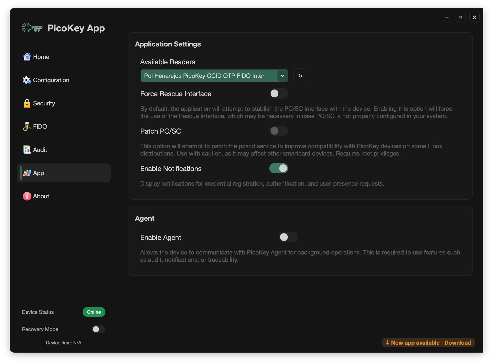

# App settings

The **application-level settings** control how PicoKey App communicates with devices and enables certain advanced features.

---

## Available readers

Choose the smart-card or USB reader interface that PicoKey App should use.

- The list shows each compatible interface that the app detects.
- The active reader is highlighted.
- Click refresh to scan for readers again.

!!! note
    In most cases, the default reader selection is sufficient and should not be changed.

---

## Force Rescue Interface

Select this option to use the **Rescue Interface** instead of the default PC/SC interface.

When enabled:

- PicoKey App bypasses the standard PC/SC stack and communicates through the Rescue Interface.
- Use it when PC/SC is unavailable or misconfigured.

!!! warning
    The Rescue Interface provides reduced functionality compared to PC/SC.

---

## Patch PC/SC

This option attempts to patch the local **pcscd service** to improve compatibility with PicoKey devices on some Linux distributions.

When enabled:

- PicoKey App changes the PC/SC service configuration.
- This may resolve compatibility issues on some distributions.

!!! danger
    This operation requires root privileges and may affect other smart card devices.
    Use with caution.

---

## Enable Notifications

Choose whether PicoKey App displays notifications when the device processes an event. Known events include:

- A site is requesting your presence by touching the button.
- A credential has been created.
- An assertion succeeds for a specific credential.

!!! note
    Notifications are sent to the Notification Center in macOS, Linux and Windows when PicoKey App is running. Enable
    PicoKey Agent for background monitoring when the main app is closed.

---

## Agent

### Enable Agent

Enable communication with **PicoKey Agent** here.

When enabled:

- This lets the device communicate with the local agent and enables advanced operations.
- The agent is required for features such as:

  - Device time synchronization

  - Audit or traceability features

  - Notification handling like user presence, credential creation or credential assertion.

!!! note
    PicoKey Agent runs as a background service and must be installed separately.

---

## Device status indicators

The bottom of the application shows the device's current status:

- Device connection status (online/offline)
- Recovery mode state
- Current device time

!!! tip
    When the agent is enabled, it updates the device time automatically.
