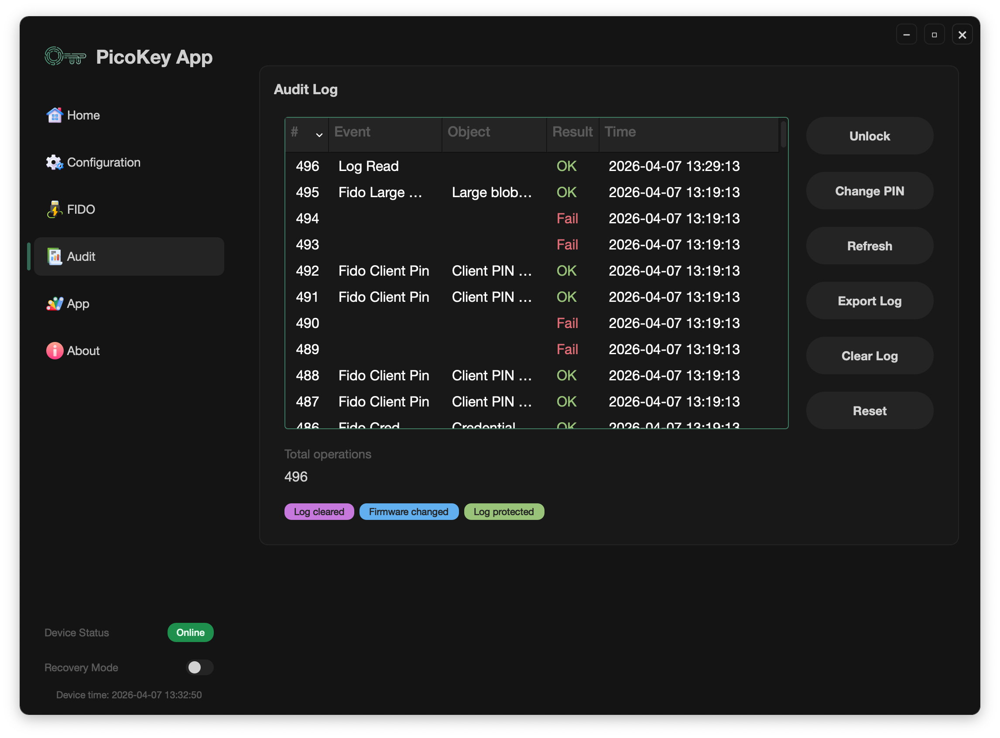

# Audit

The **Audit** section lets you review command and usage activity recorded by the PicoKey, so you can track operations performed on the device.

---

## What Audit provides

The Audit Log lists operations in chronological order and shows:

- Operation number (`#`)
- Event name
- Object/target when available
- Result (`OK` / `Fail`)
- Timestamp

The **Total operations** counter shows how many events have been recorded.

---

## Access protection (Audit PIN)

You can protect audit access with a dedicated **Audit PIN**.

From this panel you can:

- Unlock protected logs
- Set the Audit PIN (first-time setup)
- Change the Audit PIN (after setup)

---

## Log actions

Use the panel controls to manage the log:

- **Refresh**
- **Export Log**
- **Clear Log**
- **Reset**

---

## Event indicators and status flags

Status indicators call out conditions that may affect the log, including:

- Log truncated
- Log cleared
- Firmware changed
- PIN/log protection enabled
- Clock not synchronized
- Write errors while storing log entries

The screenshot shows indicators for **Log cleared**, **Firmware changed**, and **Log protected**.
