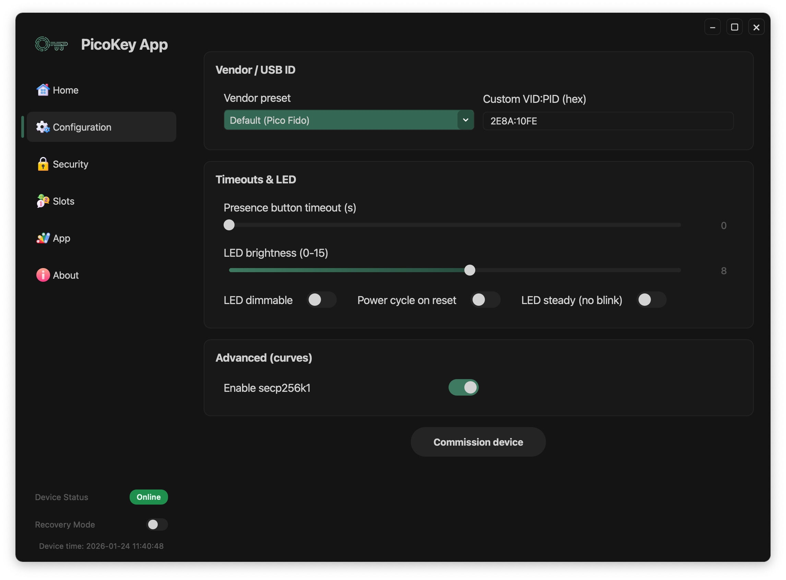

# Configuration

Use the **Configuration** section to customize and commission the device.

---

## Vendor / USB identity

Choose how the device identifies itself over USB here.

- **Vendor preset**
  Select a predefined USB identity. The default is *PicoKeys*.

- **Custom VID:PID (hex)**
  Enter a custom USB Vendor ID and Product ID.

!!! note
    Changing USB identifiers affects how the device is recognized by the operating system.
    USB Product String is modified according to the vendor presets.

---

## Timeouts & LED

This section controls user-interaction timing and the LED.

- **Presence button timeout (s)** sets how long a presence-confirmation action waits.

- **LED brightness** sets the LED intensity on a scale from 0 to 15.

- **LED dimmable** enables brightness control.

- **Power cycle on reset** forces a power cycle when the device resets.

- **LED steady (no blink)** disables LED blinking patterns.

The installed firmware determines which options are available.

---

## Advanced options

- **Enable secp256k1** enables this elliptic curve when the firmware supports it.

!!! Note
    Some old Android devices do not support this curve. Enabling it will make the device non-detectable.

---

## Commission device

Click **Commission device** to apply the selected configuration and provision the device.

A status message indicates the result of the operation.

!!! warning
    Commissioning modifies persistent device state.
    Ensure all selected options are correct before proceeding.

---

## Registration requirement

You must register the board in PicoKey App before commissioning it from this panel.
