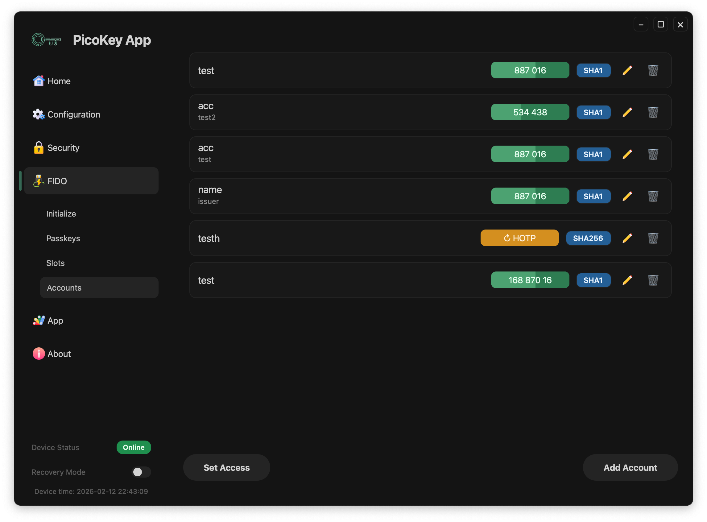
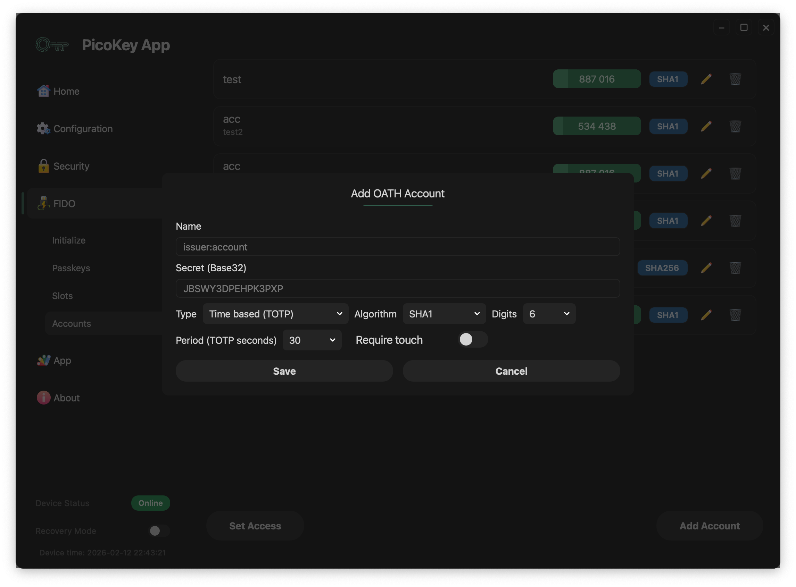
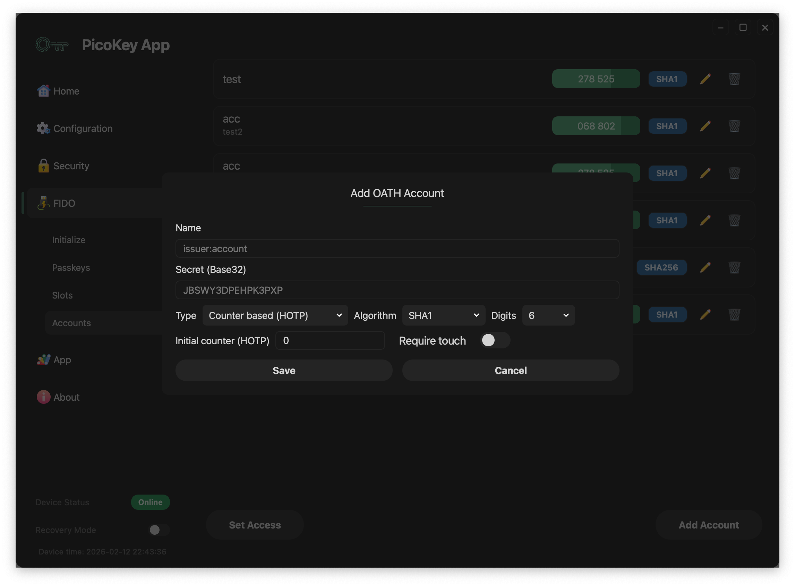
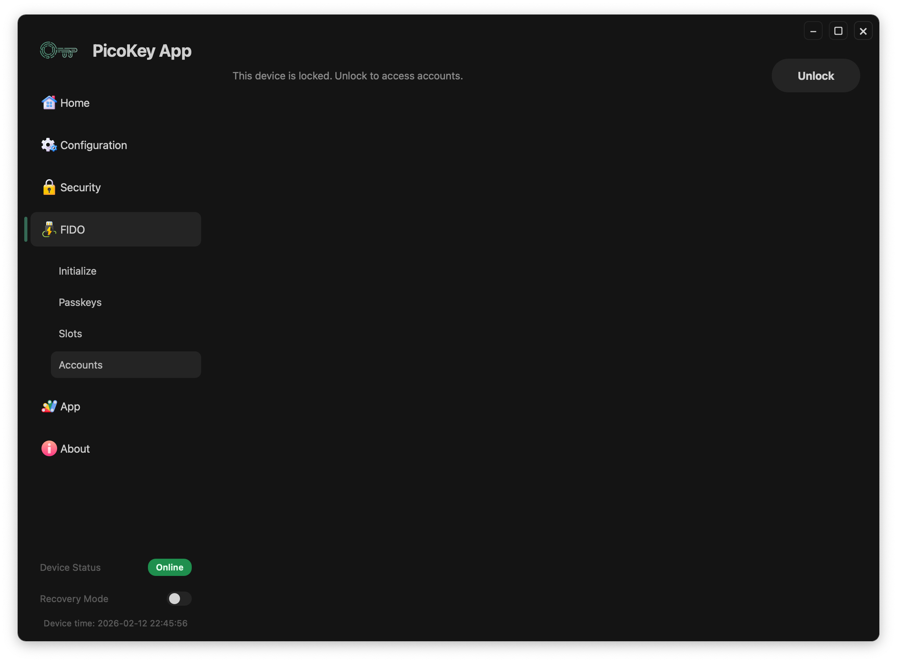

# Accounts

Use the **Accounts panel** to manage OATH accounts stored on the device.

---

## Overview

The panel lets you:

- list existing accounts;
- add TOTP and HOTP accounts;
- rename or delete accounts; and
- review account status before provisioning.

---

## Access control (OATH password)

You can protect the OATH applet with an access password. Depending on the device state, the panel offers:

- **Set Access**: define an OATH access password
- **Unlock**: unlock the OATH session
- **Change Access**: rotate the OATH access password
- **Clear Access**: remove the OATH access password

When the applet is locked, account details remain hidden until you unlock it.

---

## Adding accounts

### Add TOTP

Use the TOTP form to add an entry that generates time-based codes.

#### Fields

- **Name**: account label in the format `issuer:account`.
- **Secret**: Shared OATH secret used to generate codes.
- **Type**: `Time based (TOTP)`.
- **Algorithm**: hash algorithm (`SHA1`, `SHA256`, `SHA512`).
- **Period**: Time step in seconds for code rotation (commonly `30`).
- **Digits**: OTP output length (typically `6` or `8`).
- **Require touch**: requires user touch/presence for code use.

!!! note
    Exact field names can vary slightly depending on firmware and app version.

### Add HOTP

Use the HOTP form to add an entry that generates counter-based codes.

#### Fields

- **Name**: account label in the format `issuer:account`.
- **Secret**: Shared OATH secret used to generate codes.
- **Type**: `Counter based (HOTP)`.
- **Algorithm**: hash algorithm (`SHA1`, `SHA256`, `SHA512`).
- **Counter**: Initial counter value used for the first HOTP code.
- **Digits**: OTP output length (typically `6` or `8`).
- **Require touch**: requires user touch/presence for code use.

!!! note
    HOTP codes use a counter that advances with each code; TOTP codes rotate over time.

---

## Account operations

For each account, you can:

- **Rename**
- **Delete**

When you use the codes:

- TOTP entries refresh automatically according to their period.
- Click a TOTP or HOTP code chip to copy the current code to the clipboard.
- For HOTP, clicking the chip also calculates the next counter-based code.

---

## Locked state

When the OATH applet is protected, unlock it before viewing account data.

---

## Registration requirement

The board must be registered in PicoKey App before you can manage accounts. Otherwise, account actions are restricted.
