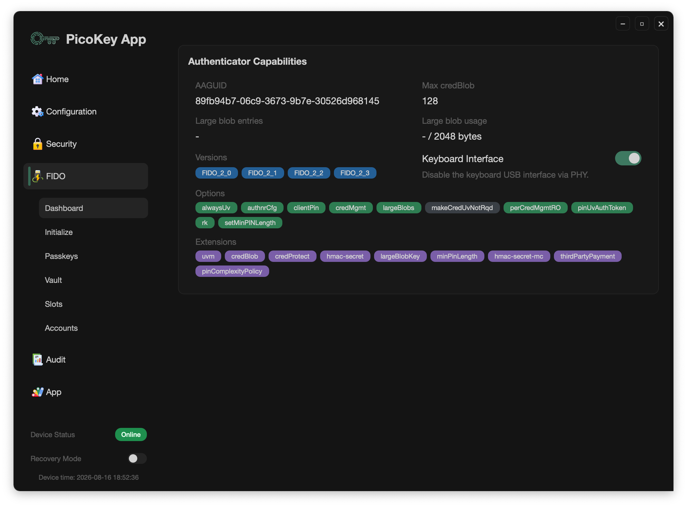

# FIDO Dashboard

The **FIDO dashboard** is the starting point for FIDO features in PicoKey App.

---

## Overview

From here, you can open:

- Passkeys management
- OTP slots management
- OATH accounts management
- Initialization and provisioning actions

Choose the area that matches what you want to manage on the connected device.

---

## Device information shown

The dashboard also shows FIDO device details, including:

- **AAGUID**
- Maximum **credBlob** size
- Number of **largeBlobs** entries
- **largeBlob** storage usage

Use these values to check the authenticator's capabilities and storage state.

## Keyboard Interface

The **Keyboard Interface** switch controls the USB keyboard interface through
the device's PHY settings.

This interface is used by the OTP slots to type configured output when the
device button is pressed. When it is disabled, PicoKey App disables the
keyboard-dependent actions for slots 1 to 4:

- Static Password
- HOTP
- Yubico OTP

Challenge-response remains available because it does not type through the USB
keyboard interface. Re-enable the switch before configuring or using the
keyboard-dependent OTP actions.

---

## Options and extensions

The dashboard lists:

- Pico FIDO options reported by the authenticator
- Supported FIDO/WebAuthn extensions

Options shown in **green** are active on the connected device.

---

## Notes

- The available actions depend on the installed firmware.
- Some actions require PIN verification before the app shows sensitive data.
