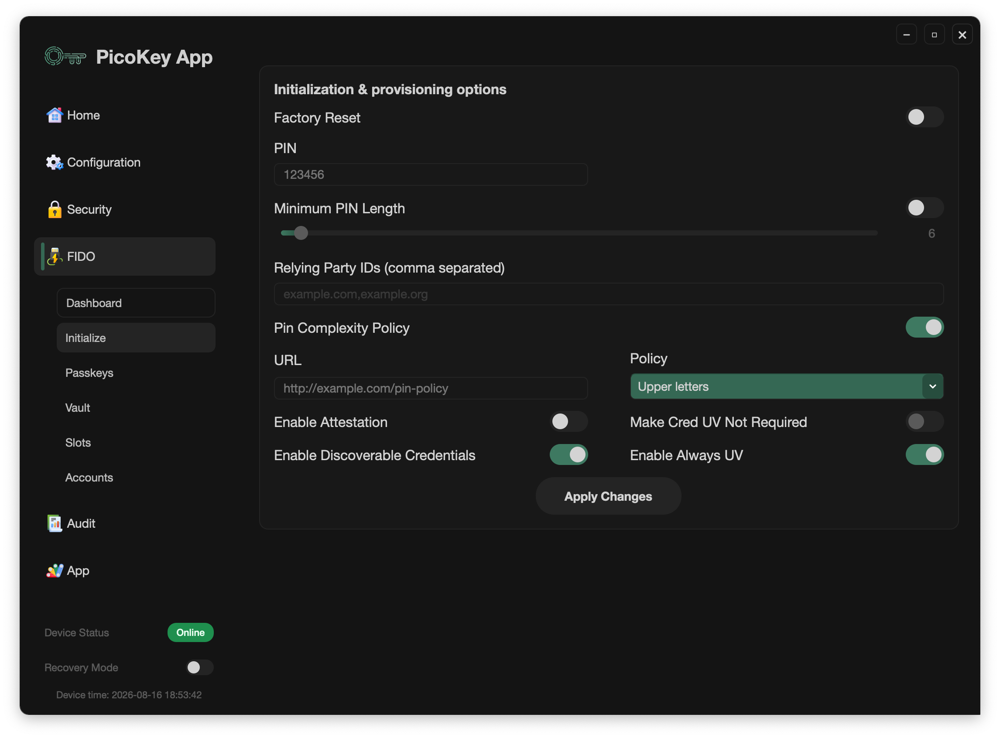

# Pico FIDO Initialization

Use PicoKey App to set the **security initialization and provisioning options** for **Pico FIDO**.

These options are **applied during initialization** and shape the authenticator's security model.

---

## Initialization options

### PIN

Set the authenticator's **user verification PIN** here.

- The PIN is required for user verification when enabled
- It protects resident credentials and sensitive operations

!!! warning
    Losing the PIN may permanently lock access to credentials.

---

### Attestation

Enable authenticator attestation here.

When enabled:

- The authenticator presents an attestation certificate
- Relying parties can identify the device type

!!! note
    Attestation may reduce user privacy depending on the relying party.

---

### Minimum PIN length

Set the minimum allowed PIN length.

- Enforced at PIN setup time
- Applies to all future PIN changes

!!! tip
    Longer PINs significantly improve resistance against guessing attacks.

### PIN complexity policy

When supported by the firmware, **PIN Complexity Policy** lets you set a policy
URL and choose one of these requirements. Enable the policy switch before
applying the URL or selecting a requirement:

- upper letters
- lower letters
- mixed letters
- digits only
- alphanumeric
- alphanumeric plus symbols

The policy is enforced by the authenticator when PINs are created or changed.

---

### RP IDs restriction

Restrict which Relying Party IDs the authenticator accepts.

- RP IDs must be explicitly listed
- Multiple RP IDs are separated by commas

!!! danger
    Incorrect RP ID configuration may prevent authentication on valid services.

### FIDO behavior toggles

The initialization panel can also expose:

- **Enable Discoverable Credentials** (`rk`): enables or disables resident
  credential creation.
- **Make Cred UV Not Required**: allows credential creation without user
  verification when the relying-party request and device policy permit it.
- **Enable Always UV**: requires user verification for applicable operations.

Use **Apply Changes** after changing these switches. Verify the resulting
options on the FIDO Dashboard before enrolling production credentials.

---

## Initialization process

After choosing the options you need:

- Click **Apply Changes**
- The device is provisioned with the selected security parameters

!!! warning
    Initialization is irreversible without a full device reset.

---

## Registration requirement

Register the board in PicoKey App before using this panel; otherwise, initialization actions are disabled.

---

## Summary

Security initialization defines the **trust model** of Pico FIDO, so choose these options to set:

- Strong authentication guarantees
- Resistance against firmware tampering
- Controlled use of attestation and PIN policies
