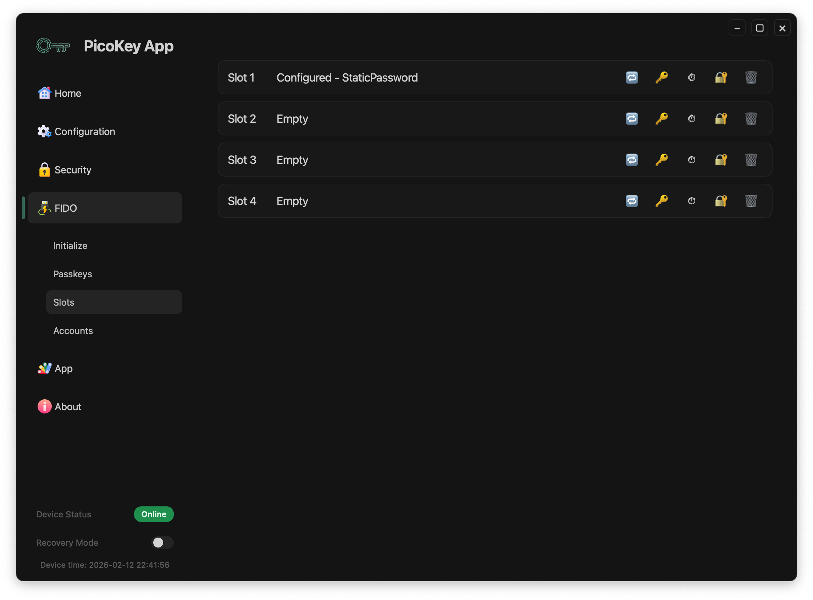

# Slots

Use the **slot management view** in PicoKey App to configure OTP and related features.

Each slot can hold an **OTP, static password, or related function** supported by the device firmware.

---

## Overview

The Slots view shows all available slots supported by the device.

Each slot is either:

- empty; or
- configured with a specific function.

Slots are independent from each other and can be configured individually.

---

## Slot activation

To activate a slot, press the **BOOTSEL** button **N consecutive times**, where `N` is the slot number.

- Slot 1: press once
- Slot 2: press twice in a row
- Slot 3: press three times in a row
- And so on for higher slot numbers

!!! note
    Presses must be consecutive so the device can map the sequence to the correct slot.

For **Static Password**, **YubiOTP**, and **HOTP** slots, activation types the configured output on the host through the USB keyboard interface.

!!! note
    This keyboard-style output does not apply to **Challenge-Response** slots.

---

## Slot states

### Empty

An empty slot has no configuration, so you can provision it for a new
function. Triggering it has no effect.

---

### Configured

A configured slot shows its number, function, and any other available details:

- The slot number
- The configuration type
- Additional information depending on the configuration

Examples of configured slots include:

- Static password
- YubicoOTP

!!! note
    The exact slot capabilities depend on the firmware running on the device.

---

## Slot actions

Use the icons to configure or manage a slot:

- [Challenge-response](slots/chalresp.md)
- [Static password](slots/static-password.md)
- [HOTP](slots/hotp.md)
- [YubiOTP](slots/yubiotp.md)
- Delete slot configuration

### Delete slot configuration

Delete the slot configuration to:

- Returns the slot to the empty state
- Removes all associated data

!!! danger
    Deleting a slot configuration permanently erases all data stored in the slot.

---

## Registration requirement

Register the board in PicoKey App before using the slot actions; otherwise, the buttons are disabled.
