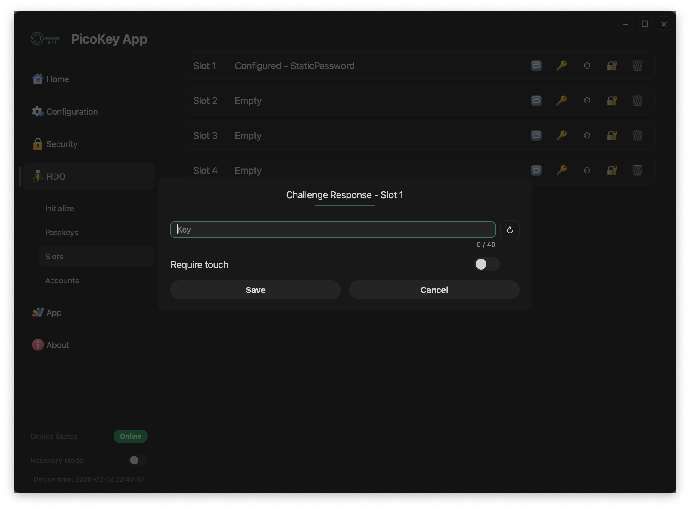

# Slot: Challenge-Response

A **Challenge-Response slot** uses a host-driven mechanism: the host creates a challenge, the device processes it, and the host verifies the response.

---

## Overview

The host application drives authentication using a secret stored on the device.
It verifies the response itself, so it does not need to keep a reusable secret.

---

## Authentication model

The host first generates a random challenge and sends it to the device. The
device uses the slot secret to process the challenge, then returns a response
for the host to verify. Authentication succeeds only when that response
matches the expected value.

!!! note
    The device does not decide whether authentication succeeds.
    Validation is entirely performed by the host.

---

## Slot configuration

### Key

Enter the **secret key** used to process challenges. The device stores it
securely, limits its length according to the slot implementation, and does
not return it in plaintext after configuration.

!!! warning
    Losing the key means the challenge-response authentication cannot be validated anymore.

---

### Require touch

When enabled, the device waits for a physical touch or confirmation before it
generates a response.

!!! note
    Requiring touch prevents unattended or automated authentication attempts.

---

## Save and cancel

- **Save** stores the slot configuration permanently.
- **Cancel** discards the changes.

!!! danger
    Saving overwrites any existing slot configuration.

---

## Security properties

Random challenges help prevent replay attacks. The slot does not send a static
secret over the interface, and you can require user presence before it
responds.

!!! warning
    Security depends entirely on correct challenge generation and verification on the host side.

---

## Typical use cases

Challenge-Response slots are commonly used for:

- Device-bound authentication for custom applications
- Licensing or entitlement checks
- Secure device identification
- Anti-cloning mechanisms

!!! tip
    Always use cryptographically strong random challenges.

---

## Limitations

The device does not verify the response, the protocol is application-specific,
and the host must implement verification.

!!! note
    This slot is intended for advanced users and custom integrations.

