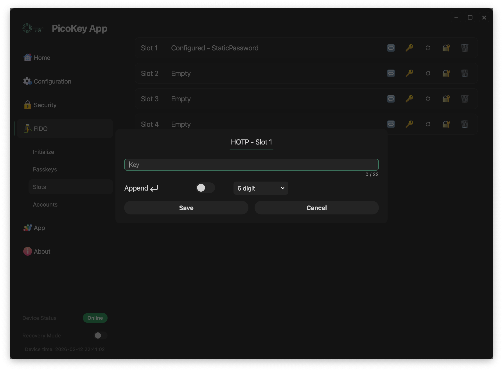

# Slot: HOTP

An **HOTP (HMAC-Based One-Time Password) slot** generates a numeric code from a shared secret and types it as **keyboard input** when triggered.

---

## Overview

The device stores a shared secret and uses it to generate HOTP codes when the
slot is activated. It types each code through its USB keyboard interface, and
a remote system verifies the code using the same secret.

---

## Activation mechanism

The HOTP slot is activated through the **OTP / button interface**.

Press the BOOTSEL button **N times**, where `N` is the slot number. The device
then generates the next HOTP value and types it into the host as keyboard
input.

!!! note
    No dedicated software is required on the host beyond USB HID keyboard support.

---

## Slot configuration

### Key

Enter the shared secret used to generate HOTP values. The device stores it
securely and does not return it after setup; the slot implementation also
limits its maximum length.

!!! warning
    If the secret is lost, the HOTP sequence cannot be regenerated or validated.

---

### Number of digits

Choose how many digits the generated code contains:

Supported values:

- 6 digits
- 8 digits

!!! note
    The verifier must be configured to expect the same number of digits.

---

### Append Enter

When enabled, the device sends Enter after the code, which can submit a form
automatically.

!!! tip
    Enable this option when authenticating into login forms or terminals.

---

## Save and cancel

- **Save** stores the HOTP configuration permanently.
- **Cancel** discards the changes.

!!! danger
    Saving overwrites any existing slot configuration.

---

## Security considerations

Each activation generates a new code. The device keeps the shared secret
private and emits the code only as keyboard input.

!!! warning
    HOTP counters must remain synchronized with the verification system.

---

## Typical use cases

Use HOTP slots for:

- Two-factor authentication systems
- Legacy systems without TOTP support
- Offline authentication scenarios
- Environments requiring keyboard-based OTP input

!!! tip
    Ensure proper counter resynchronization policies on the server side.

---

## Limitations

HOTP uses a counter rather than time, so the device and verifier can become
desynchronized. The verifier must check each code, and the device emits codes
only through the keyboard interface.

!!! note
    For time-based OTP, consider using TOTP-capable solutions if available.
