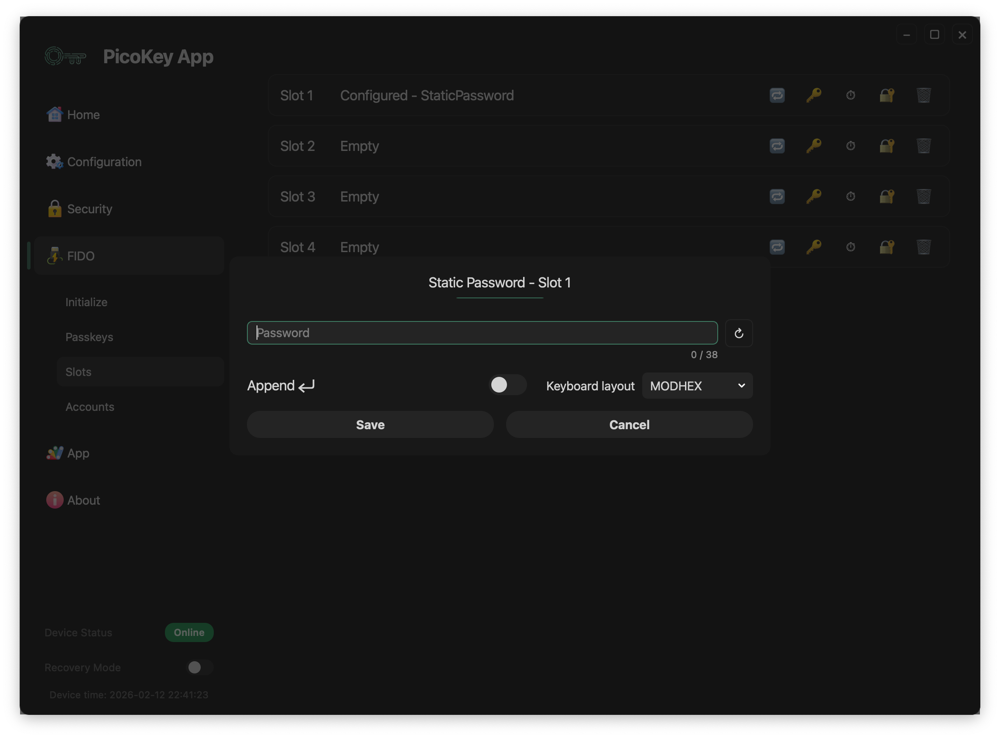

# Slot: Static Password

A **Static Password slot** stores a fixed password and types it as **keyboard input** when triggered.

---

## Overview

The device stores a fixed password and types it through its USB keyboard
interface when the slot is activated. This works with systems that accept
keyboard input.

---

## Activation mechanism

The Static Password slot is activated through the **OTP / button interface**.

Press the BOOTSEL button **N times**, where `N` is the slot number. The device
then types the stored password into the host as keyboard input.

!!! note
    No software on the host is required beyond standard USB HID keyboard support.

---

## Slot configuration

### Password

Enter the fixed password for this slot. The device stores it securely and
does not return it after setup; the slot implementation also limits its
maximum length.

!!! warning
    Losing the password means it cannot be recovered from the device.

---

### Append Enter

When enabled, the device sends Enter after the password, which can submit a
form automatically.

!!! tip
    Enable this option when logging into terminals or login forms.

---

### Keyboard layout

The selected layout controls how characters map to keyboard scancodes. Match
it to the host's keyboard layout to avoid incorrect characters.

!!! warning
    A mismatched keyboard layout may produce incorrect characters.

---

## Save and cancel

- **Save** stores the password permanently in the slot.
- **Cancel** discards the changes.

!!! danger
    Saving overwrites any existing slot configuration.

---

## Security considerations

The device does not expose the password through software interfaces; it types
it through the keyboard interface and does not require host authentication to
trigger the slot.

!!! warning
    Anyone with physical access to the device may trigger the slot.

---

## Typical use cases

Static Password slots can help with:

- Login to systems without password managers
- Unlocking encrypted volumes
- Entering recovery passwords
- Automating repetitive authentication steps

!!! tip
    Use Static Password slots only on trusted systems.

---

## Limitations

This slot does not use challenge-response or host-side verification. Because
the password is fixed and typed visibly, it can be exposed through shoulder
surfing or screen recording.

!!! note
    This slot prioritizes convenience over cryptographic authentication.

