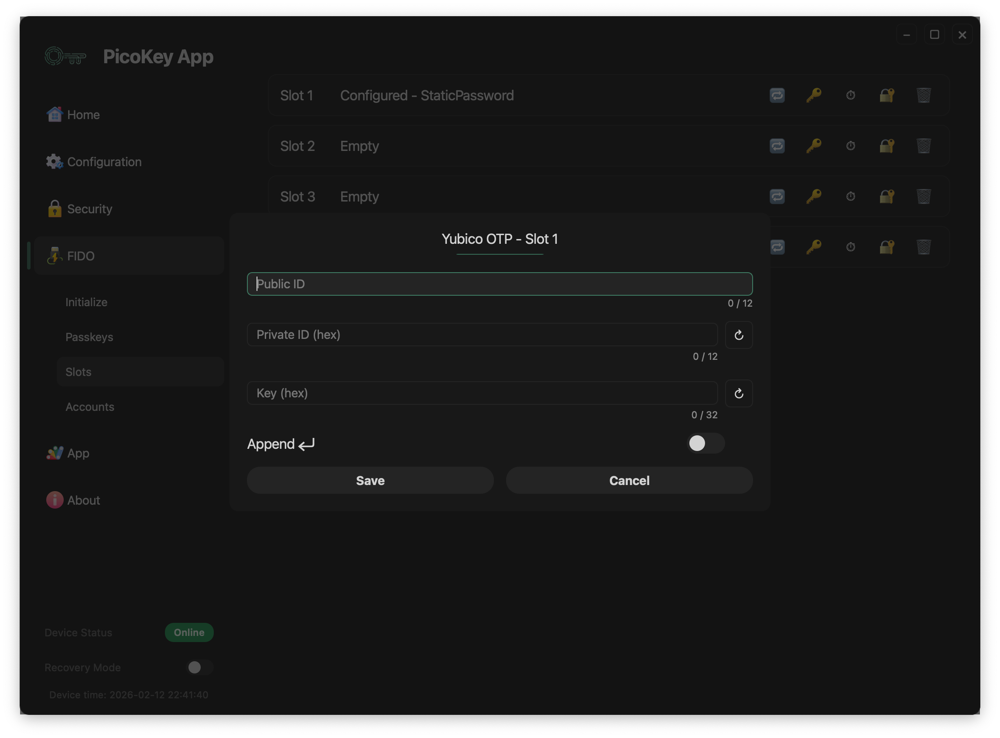

# Slot: Yubico OTP

A **Yubico OTP slot** generates one-time passwords according to the **Yubico OTP specification** and types them as **keyboard input** when triggered.

---

## Overview

The device stores Yubico-compatible identifiers and secret keys, then uses
them to generate OTP values when the slot is activated. It types each code
through its USB keyboard interface for services that support Yubico OTP.

---

## Activation mechanism

The Yubico OTP slot is activated through the **OTP / button interface**.

Press the BOOTSEL button **N times**, where `N` is the slot number. The device
then generates a Yubico OTP and types it into the host as keyboard input.

!!! note
    No additional software is required on the host beyond USB HID keyboard support.

---

## Slot configuration

### Public ID

Enter the **public identifier** that the verification service uses to identify
the device. It is sent in clear as part of the OTP and is limited in length by
the Yubico specification.

---

### Private ID (hex)

Enter the **private identifier** in hexadecimal format. The device stores it
securely and uses it internally when generating OTP values.

!!! warning
    The private ID cannot be retrieved once stored.

---

### Key (hex)

Enter the **secret key** in hexadecimal format. The device stores it securely
and does not expose it outside the device.

!!! danger
    Losing the secret key prevents OTP verification and cannot be recovered.

---

### Append Enter

When enabled, the device sends Enter after the OTP, which can submit a form
automatically.

!!! tip
    Enable this option when authenticating on web login forms.

---

## Save and cancel

- **Save** stores the Yubico OTP configuration permanently.
- **Cancel** discards the changes.

!!! danger
    Saving overwrites any existing slot configuration.

---

## Security considerations

The slot follows the Yubico OTP specification and keeps its secrets out of
software interfaces. It emits OTPs only as keyboard input.

!!! warning
    Anyone with physical access to the device may trigger OTP generation.

---

## Typical use cases

Use Yubico OTP slots for:

- Authentication against Yubico-compatible servers
- Legacy systems using Yubico OTP
- Environments requiring keyboard-based OTP input

!!! tip
    Ensure the verification backend is correctly configured with matching identifiers and keys.

---

## Limitations

The service must support Yubico OTP, and the device emits the code through its
keyboard interface without host-side confirmation.

!!! note
    This slot is intended for compatibility with existing Yubico OTP infrastructures.

