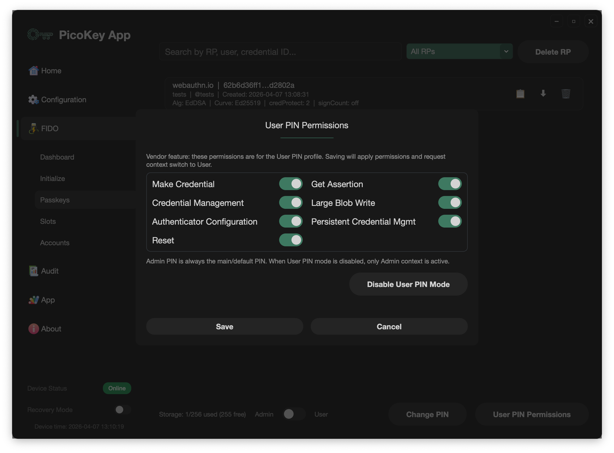

# User PIN (Vendor Feature)

The User PIN feature adds a second FIDO PIN context with its own permissions.

## Purpose

This feature supports **multi-user FIDO passkeys** by letting an Admin choose which operations the User context can perform.

Typical use case: an organization configures the key with a manager/admin account first, then hands the key to a worker account with reduced administration permissions.

---

## What this feature adds

This vendor extension is implemented by PicoKey firmware and PicoKey App; it is outside the standard FIDO behavior.

The device can operate with two PIN contexts:

- **Admin PIN**: full management permissions.
- **User PIN**: restricted permissions defined by the Admin.

Each context has its **own PIN value**.

---

## Permission model

When `User PIN` is enabled, Admin can set which Passkeys management actions the User context may perform.

The following permissions can be enabled or disabled for User context:

- Create credentials
- Credential management
- Authentication
- Large Blob write
- Configure authenticator
- Persistent credential management
- Reset authenticator

By default:

- All permissions are enabled by default.
- **Authentication is always enabled** and cannot be effectively removed, otherwise the user would not be able to authenticate to any service.

Admin context keeps full access regardless of User restrictions.

---

## Default context behavior

- If `User PIN` is **disabled**: only Admin context is active.
- If `User PIN` is **enabled**: device defaults to **User context** after each connect/reconnect.

When User PIN is enabled, PicoKey App opens in User context after each connection unless you switch to Admin.

---

## Context switching in PicoKey App

Switch contexts in **FIDO > Passkeys**.

The switch is available only after a PIN has been configured for the active context.

Operational sequence:

1. Connect device (loads User context by default when enabled).
2. Unlock first (context switch requires an unlocked state).
3. Switch context to Admin when elevated actions are required.
4. If needed, unlock with the PIN of the selected context to continue protected operations.

If you need to disable User PIN, switch to Admin context first, then disable User PIN.

---

## Practical notes

- Keep the Admin and User PINs as separate credentials.
- Give the User context only the permissions it needs.
- If management actions are unavailable, check the current context before troubleshooting.
