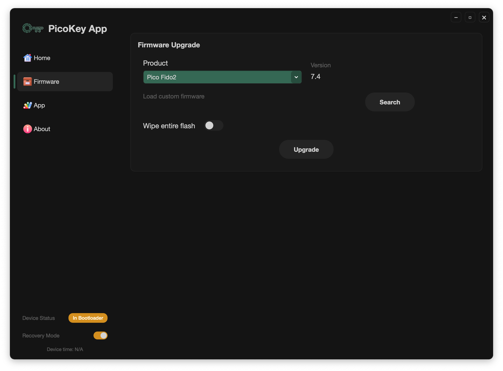

# Firmware update

Use **PicoKey App** to update the firmware running on a PicoKeys device.

Firmware updates modify the software running on the device and may affect available features and behavior.

---

## Overview

An update can:

- install a different firmware variant, such as Pico HSM, Pico FIDO, or Pico OpenPGP;
- update the current firmware; or
- recover a device with corrupted or incomplete firmware.

Firmware updates are **explicit user actions** and are never performed automatically.

---

## Supported update modes

Depending on the firmware and device state, PicoKey App may support updates in
**BOOTSEL / RESCUE mode**. New or freshly flashed devices are expected to be in
**RESCUE mode**.

For regular firmware variants, upgrade actions require a registered board in PicoKey App. Rescue firmware update paths may still be available for recovery workflows.

---

## Before you start

Before you start the update:

- Ensure the device is connected directly to the computer
- Avoid USB hubs during the update
- Close other applications that might access the device
- Do not disconnect the device during the process

!!! Warning
    Interrupting a firmware update may leave the device in a recovery state
    and require manual intervention.

---

## Entering BOOTSEL / RESCUE mode

If the device is not already in BOOTSEL / RESCUE mode:

1. Go to **Home**
2. Click **Reboot to BOOTSEL**
3. Wait for the device to reconnect

Once in BOOTSEL / RESCUE mode, PicoKey App should detect the device again.

---

## Performing a firmware update

To install an update:

1. Open the firmware update section in PicoKey App
2. Use **Search** to pick the firmware file to be installed
   (firmware files are usually provided as a binary image)
3. Click **Upgrade** to start the update process
4. Wait until PicoKey App reports completion
5. Reconnect the device if requested

You can also load a **specific firmware file from local disk** using the file search/open action in the firmware panel (custom firmware path).

While the update runs:

- Progress information may be displayed
- The device may temporarily disconnect and reconnect

---

## Wipe entire flash (advanced)

The firmware panel includes an optional **Wipe entire flash** checkbox.

When enabled, PicoKey App erases flash sectors before writing the new firmware.

Use this only when you explicitly need a full cleanup (for example recovery scenarios), because it removes previous flash contents.

!!! warning
    A full wipe is destructive and may require full reconfiguration or commissioning after flashing.

---

## After the update

After the update completes:

- The device may reboot automatically
- The reported firmware version should change accordingly
- Available features in PicoKey App may change depending on the firmware

Then:

- Return to **Home**
- Verify firmware version and device status
- Perform commissioning if required by the new firmware

---

## Firmware update and configuration

Installing a different firmware may:

- Reset some configuration settings
- Require re-commissioning
- Change available configuration or security options

!!! Note
    Firmware functionality is defined by the installed firmware,
    not by PicoKey App itself.

---

## If something goes wrong

If an update fails:

- Do not unplug the device immediately
- Follow any instructions shown by PicoKey App
- If the device enters BOOTSEL / RESCUE mode, retry the update

If recovery is not possible or behavior is unclear, open a ticket at:

[https://github.com/polhenarejos/picokeyapp/issues](https://github.com/polhenarejos/picokeyapp/issues)

Include:

- PicoKey App version
- Firmware version (if known)
- Device platform and board model
- A description of what happened and at which step

---

## Important notes

- Firmware updates are explicit and user-controlled
- PicoKey App does not automatically select or install firmware
- Always verify that you are installing the correct firmware variant for your device
