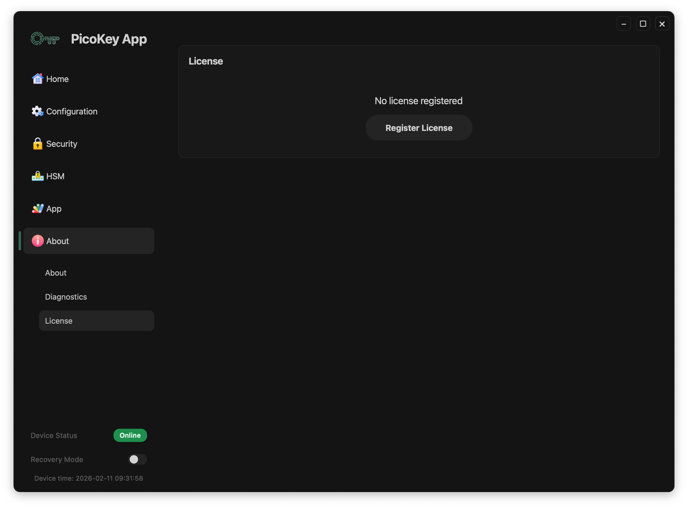
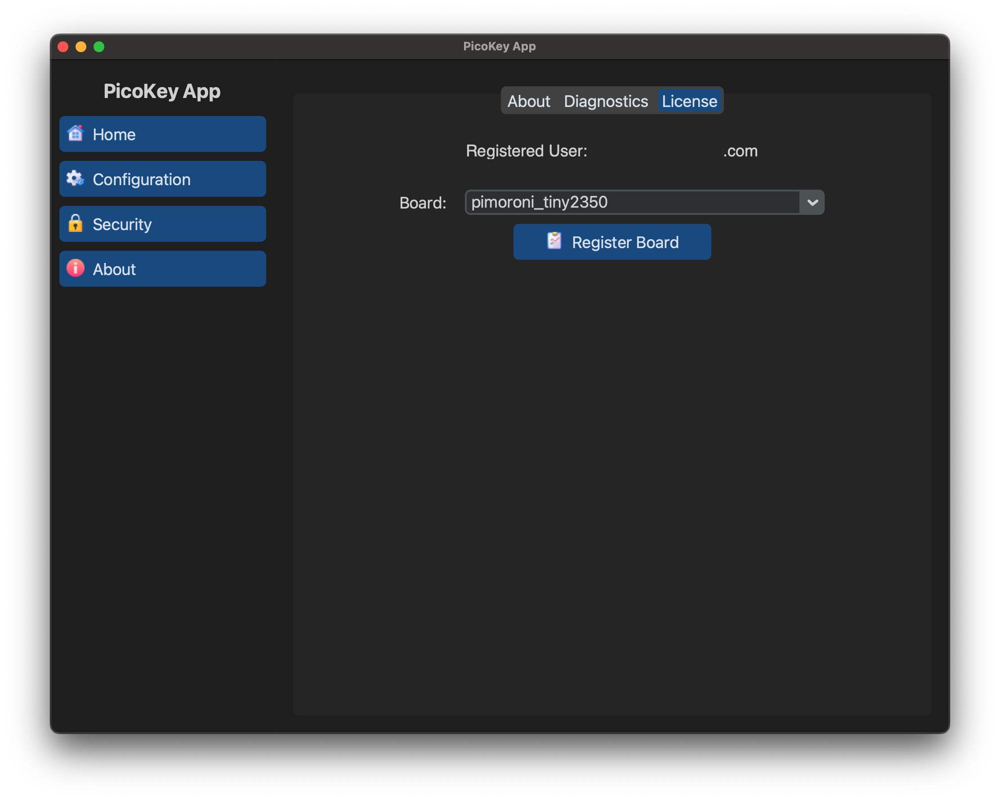

# First-time use

The first time you use PicoKey App with a new device, complete the steps below.
Some actions are **irreversible**, so check each selection before continuing.

---

## Overview

You will need to:

1. Install a valid license
2. Connect a compatible PicoKeys device
3. Select the **correct board type**
4. Register the board
5. Commission the device

Some of these steps **cannot be undone**.

---

## Step 1: Install a license

Before a device can be registered, a **valid license must be installed**.

1. Open **About → License**
2. If no license is installed, the status will show **Not registered**
3. Click **Register License**
4. Enter or import your license
5. Confirm that the license is accepted

After installing the license:

- The license is installed locally
- No device is registered yet

---

## Step 2: Connect the device

1. Plug the PicoKeys device into a USB port
2. Use a direct USB connection whenever possible
3. Launch PicoKey App if it is not already running

Go to **Home** and verify that:

- The device is detected
- A green **Device detected** indicator is shown

If the device is not detected:

- Try a different USB cable or port
- Close other applications that may be accessing the device
- Reconnect the device and restart PicoKey App

---

## Step 3: Select the board type (mandatory)

Before registering the board, **you must explicitly select the correct board type**.

You must choose the board type yourself before registering it.

- The board type defines the hardware variant associated with the license
- PicoKey App cannot automatically infer the correct board in all cases
- The user is responsible for selecting the correct option

!!! Warning
    Once the board type is selected and the board is registered,
    **the board type cannot be changed**.

!!! info
    Do not attempt to register the board in BOOTSEL mode. Proceed with a
    PicoKey firmware running normally.

---

## Step 4: Register the board

After selecting the board type:

1. Go to **About → License**
2. Select the target board
3. Click **Register Board**
4. Wait for confirmation

After registration:

- The license is bound to the selected board
- The board status changes to **Registered**

This license-to-board binding cannot be undone.

---

## Step 5: Commission the device

After board registration, the device must be commissioned.

1. Go to **Configuration**
2. Review the available configuration options
3. Click **Commission device**
4. Wait for the confirmation message

Commissioning then:

- Applies the selected configuration
- Writes persistent state to the device
- Prepares the device for normal operation

---

## If your board is not listed

If **your board model does not appear** in the board selection list:

- **Do not proceed**
- Do not select a different or “similar” board

Instead, open a support ticket at:

[https://github.com/polhenarejos/picokeyapp/issues](https://github.com/polhenarejos/picokeyapp/issues)

Include:

- The exact board model
- The version
- The firmware version running on the device
- Any relevant screenshots or logs

---

## Summary

Before you finish, confirm that:

- Installing a license is mandatory
- The board type must be selected manually by the user
- Board selection is **irreversible**
- Commissioning finalizes the setup
- If the correct board is not listed, open a ticket before continuing
