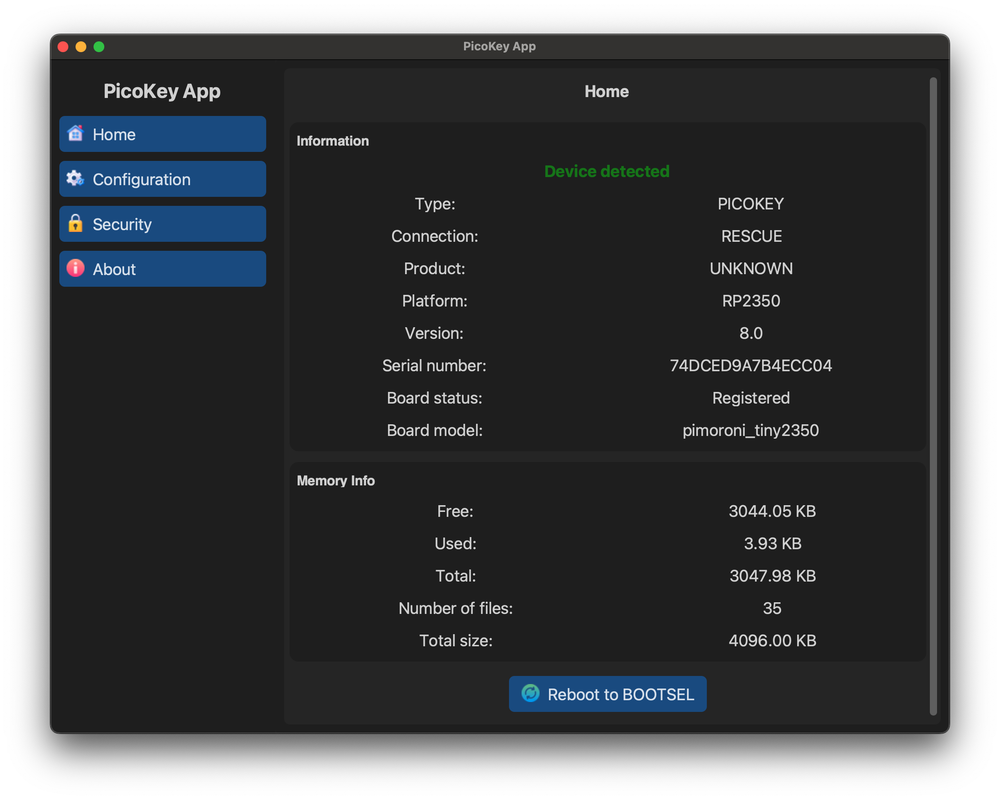

# Home

The **Home** section shows an overview of the connected device.

---

## Device detection

When PicoKey App detects a device, it shows:

- **Type:** device family (e.g. `PICOKEY`)
- **Connection:** current connection mode (e.g. `RESCUE`)
- **Product:** firmware-reported product type
- **Platform:** MCU platform (e.g. `RP2350`)
- **Version:** firmware version
- **Serial number:** unique device identifier
- **Board status:** registration state (Registered / Not registered)
- **Board model:** hardware model identifier

The green *Device detected* indicator confirms that the app can communicate with the device.

---

## Memory information

The **Memory Info** section reports the device's filesystem usage:

- Free memory
- Used memory
- Total memory
- Number of files
- Total filesystem size
- Firmware size

Use these values to check available space or investigate unusual storage usage.

---

## Reboot to BOOTSEL

Click **Reboot to BOOTSEL** to restart the device in BOOTSEL recovery mode.

!!! warning
    BOOTSEL mode should only be used when required (firmware update or recovery).
    Interrupting critical operations may require manual recovery.

## Device status indicators

The bottom of the application shows the device's current status:

- Device connection status (online/offline)
- Recovery mode state
- Current device time

!!! tip
    When the agent is enabled, it updates the device time automatically.
