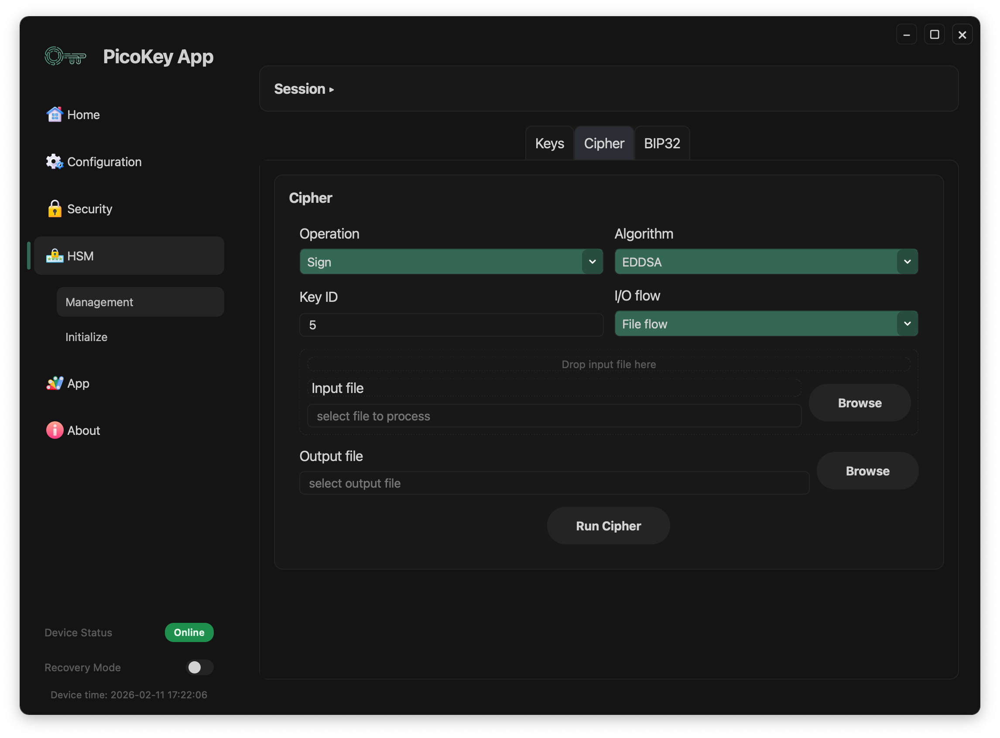
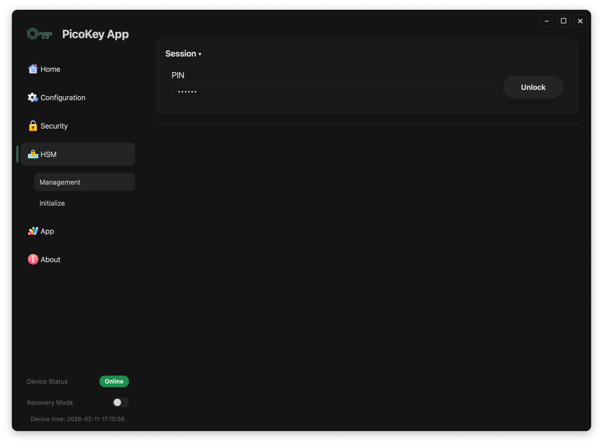
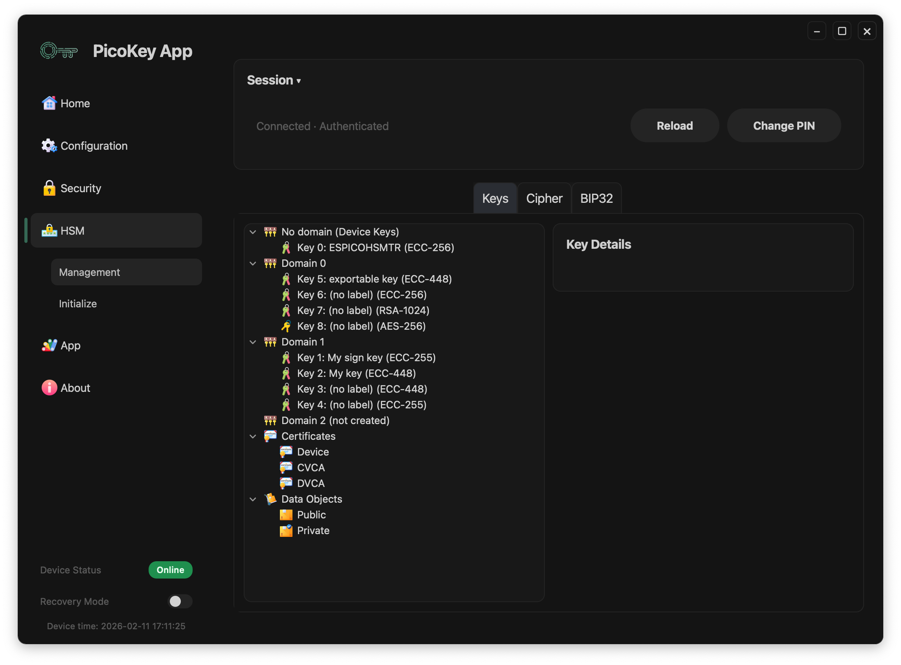
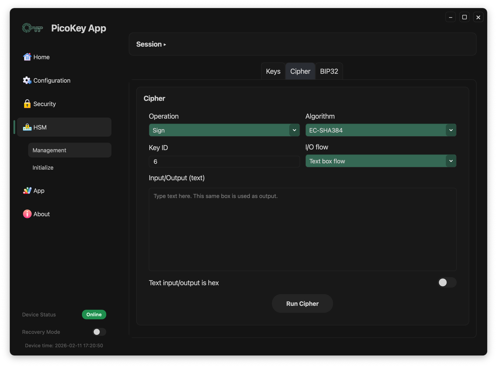
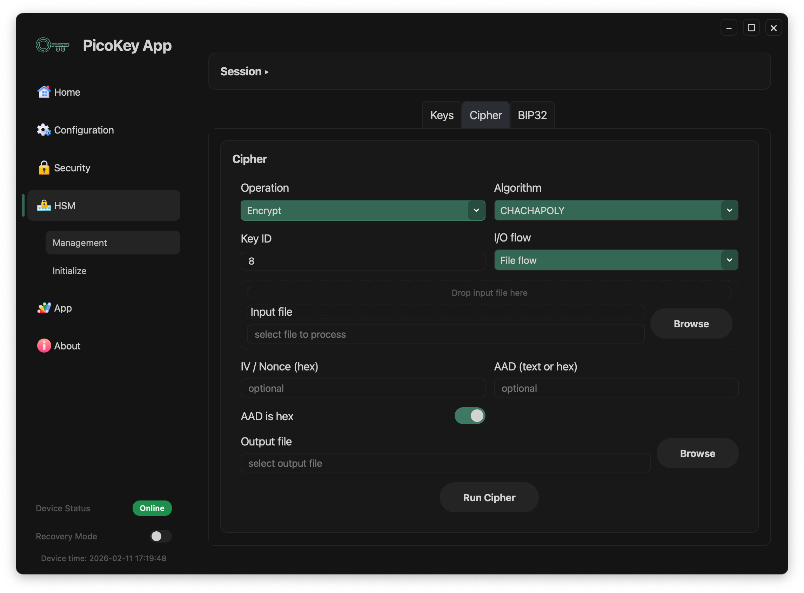
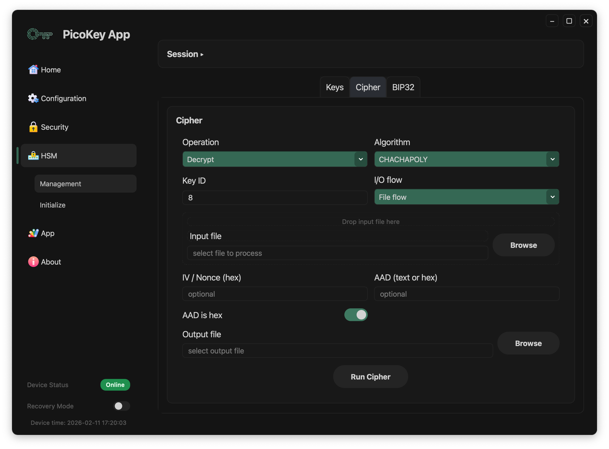
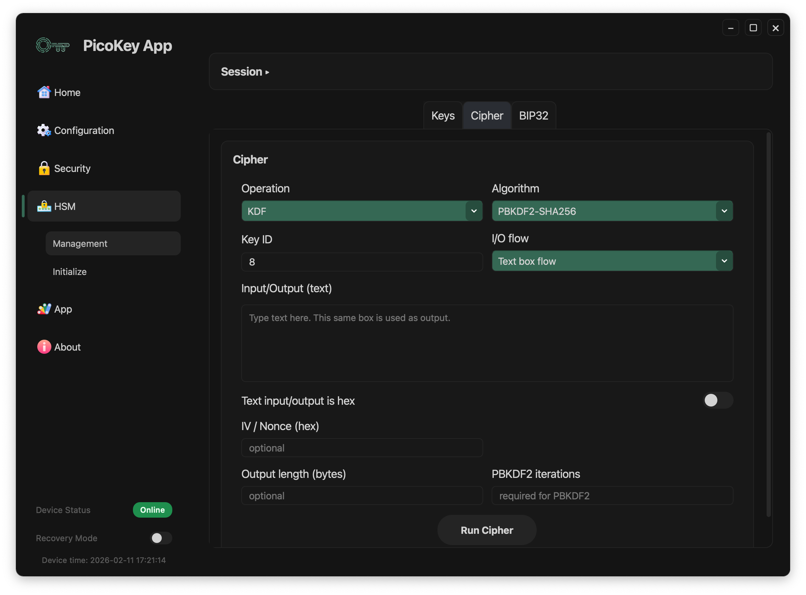

# Pico HSM Cipher

Use **HSM > Management > Cipher** in PicoKey App to run operations with an existing key.

The `Cipher` tab runs cryptographic operations using the selected `Key ID`.

---

## Prerequisite

Before you run an operation:

1. Go to `HSM > Management`.
2. Enter `PIN`.
3. Click **Unlock**.
4. Wait until keys are loaded.
5. If needed, expand `Session` and use **Reload** / **Change PIN**.
6. Use a valid `Key ID`.

---

## Main controls

- **Operation**: `Sign`, `Decrypt`, `Encrypt`, `MAC`, `KDF`
- **Algorithm**: available values depend on key type and selected operation
- **Key ID**: key handle used by the operation
- **I/O flow**: `File flow` or `Text box flow`
- **Run Cipher**: executes the selected operation

---

## I/O flow

Choose between two input and output modes.

### File flow

Use files as input and output.

The file flow reads from **Input file** or the drop zone, then writes the result
to **Output file**. Use the **Browse** buttons to choose the paths.

### Text box flow

Use a single text area for both input and output.

Enter plaintext, data, or signing input in the text box. After the operation,
the app replaces the input with the result. Use `Text input/output is hex` to
switch between plain text and hexadecimal input/output.

---

## Operation-specific fields

- `Encrypt`/`Decrypt` with AEAD/stream-like modes can require **IV / Nonce (hex)** and optional **AAD (text or hex)**.
- `MAC` uses file/text input and writes tag output.
- `KDF` can include **Output length (bytes)** and, for PBKDF2, **PBKDF2 iterations**.

---

## Algorithm availability by key type

### EdDSA keys (`ed25519`, `ed448`)

- Only `Sign` is available.
- The only signature algorithm is `EDDSA`.

### Other ECC keys

- `Sign` supports:
- `EC-RAW`
- `EC-SHA1`
- `EC-SHA224`
- `EC-SHA256`
- `EC-SHA384`
- `EC-SHA512`

### RSA keys

- `Sign` supports:
- `RSA-RAW`
- `RSA-PKCS1`
- `RSA-PKCS1-SHA1`
- `RSA-PKCS1-SHA224`
- `RSA-PKCS1-SHA256`
- `RSA-PKCS1-SHA384`
- `RSA-PKCS1-SHA512`
- `RSA-PSS`
- `RSA-PSS-SHA1`
- `RSA-PSS-SHA224`
- `RSA-PSS-SHA256`
- `RSA-PSS-SHA384`
- `RSA-PSS-SHA512`

- `Decrypt` supports:
- `RSA-RAW`
- `RSA-PKCS1`
- `RSA-OAEP`

### AES keys (symmetric keys)

- `Encrypt` / `Decrypt` support:
- `CHACHAPOLY`
- `AES-ECB`
- `AES-CBC` (input length must be a multiple of 16 bytes)
- `AES-OFB`
- `AES-CFB`
- `AES-GCM`
- `AES-CCM`
- `AES-CTR`
- `AES-XTS`

- `MAC` supports:
- `CMAC`
- `HMAC-SHA1`
- `HMAC-SHA224`
- `HMAC-SHA256`
- `HMAC-SHA384`
- `HMAC-SHA512`

- `KDF` supports:
- `HKDF-SHA256`
- `HKDF-SHA384`
- `HKDF-SHA512`
- `PBKDF2-SHA1`
- `PBKDF2-SHA224`
- `PBKDF2-SHA256`
- `PBKDF2-SHA384`
- `PBKDF2-SHA512`
- `X963-SHA1`
- `X963-SHA224`
- `X963-SHA256`
- `X963-SHA384`
- `X963-SHA512`

!!! note
    The selector omits algorithms for operations that the selected key type does not support.
