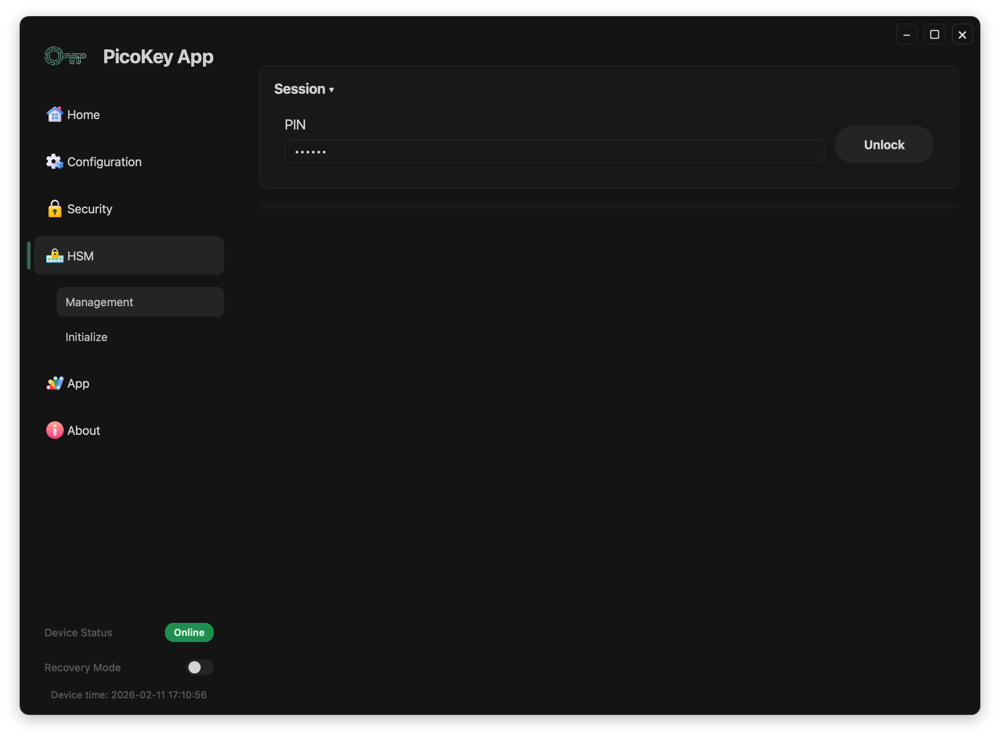
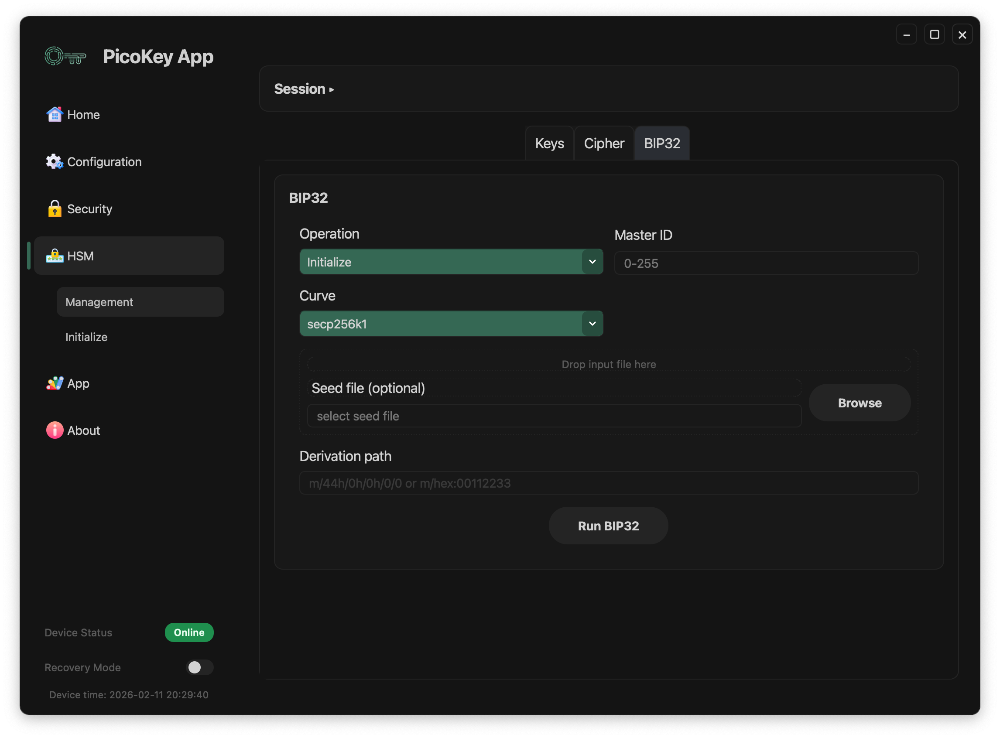
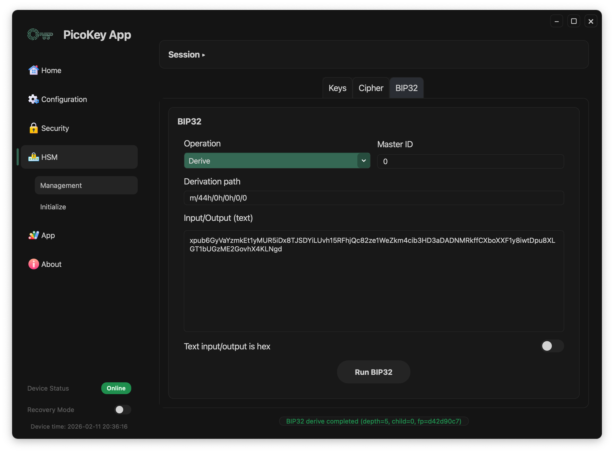
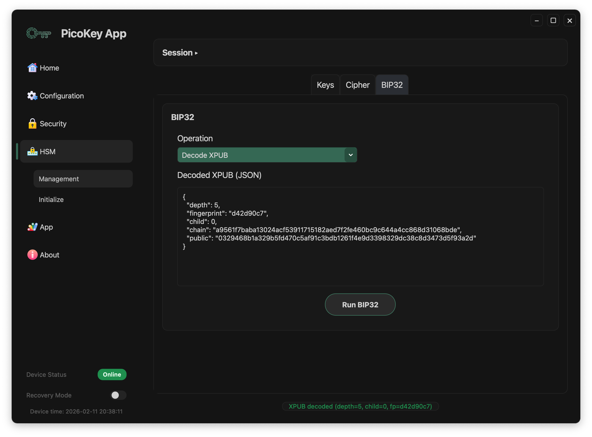
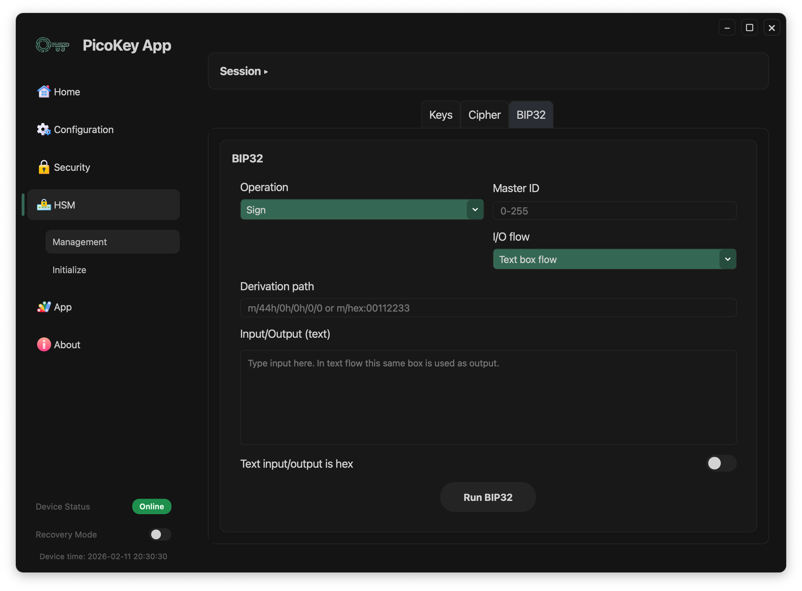
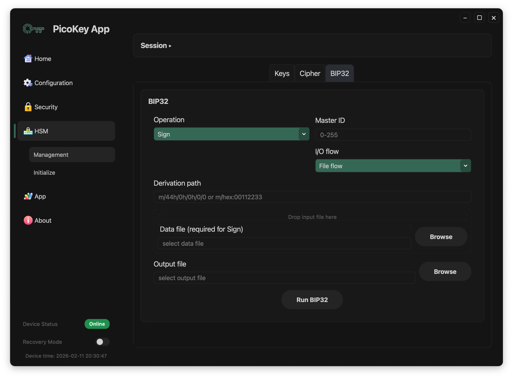

# Pico HSM Hierarchical Deterministic (HD / BIP32)

Use **HSM > Management > BIP32** in PicoKey App to manage hierarchical deterministic keys.

The BIP32 tab lets you:

- Initialize master material
- Derive child keys / XPUB data by derivation path
- Decode XPUB
- Sign using a derivation path

---

## Prerequisite

Before running a BIP32 operation:

1. Go to `HSM > Management`.
2. Enter `PIN`.
3. Click **Unlock**.
4. Wait until keys are loaded.
5. Use the `BIP32` tab.

---

## Main controls

The main controls are:

- **Operation**: `Initialize`, `Derive`, `Decode XPUB`, `Sign`
- **Master ID**: identifier that binds a master node to its curve type (`0-255`)
- **Derivation path**: path format such as `m/44h/0h/0h/0/0`
- **Run BIP32**: executes the selected operation

Supported master curve types:

- `secp256k1`
- `secp256r1`
- Symmetric key (`SLIP`)

---

## Initialize

Initialize HD material for the selected master ID.

Visible fields:

- **Curve** (example shown: `secp256k1`)
- **Seed file (optional)**: optional seed input from file
- **Derivation path**

If you leave **Seed file (optional)** empty, the device generates the seed according to its firmware behavior.

---

## Derive

Derives BIP32 child output from a derivation path and selected master.

Visible fields:

- **Derivation path**
- **Input/Output (text)**: output is written in the same box
- **Text input/output is hex** toggle

After execution, the bottom message area shows status information, including the depth, child, and fingerprint.

---

## Decode XPUB

Decode an XPUB value to view its metadata as JSON.

Visible output:

- `depth`
- `fingerprint`
- `child`
- `chain`
- `public`

The decoded payload is shown in **Decoded XPUB (JSON)**.

---

## Sign with derivation path

BIP32 signing uses the selected master plus derivation path.

As in the Cipher tab, signing supports both text-box and file flows.

### Sign with text box flow

Enter data in **Input/Output (text)**. After signing, the app replaces it with
the output. Use `Text input/output is hex` to switch between plain text and
hexadecimal input/output.

### Sign with file flow

Choose the file to sign with **Data file (required for Sign)**, then select a
destination with **Output file**. The **Browse** buttons open the file picker.

---

## Notes

- Use `Master ID` to keep multiple independent HD roots, each associated with its selected curve type.
- A valid derivation path is required for derive/sign operations.
- `BIP32` operations are available only after a successful unlock.
