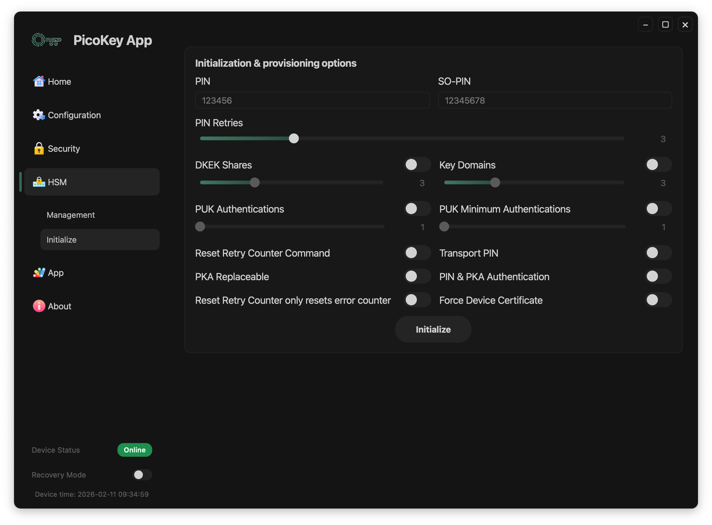

# Pico HSM Initialization

Use PicoKey App to set the **security initialization options** for **Pico HSM**.

These settings define **PIN policies, key protection, and recovery options**.

---

## PIN configuration

### User PIN

Set the primary user PIN here.

- Required for cryptographic operations
- Protects private keys and stored objects

!!! tip
    The default PIN is `648219`.

---

### SO PIN

Set the Security Officer PIN here.

- Used for administrative operations
- Required for certain reset and recovery commands

!!! note
    The SO PIN should be stored separately from the user PIN.

---

### PIN retries

Choose how many incorrect PIN attempts are allowed.

- Applies to both user PIN and SO PIN
- Exceeding the limit blocks access

!!! danger
    Exceeding retry limits may permanently lock the device.

---

## Advanced protection options

### DKEK shares

Enables **Distributed Key Encryption Key** (DKEK) shares.

- Splits the encryption key into multiple shares
- Requires a threshold number of shares for recovery

!!! note
    This option is only useful when no key domains are configured. Otherwise, each
    key domain can be configured independently with different DKEK shares.

---

### PUK authentications

Set how many public keys can be used for authentication.

- Used when PKA is enabled
- Adds an additional authentication mechanism without PIN

---

### PUK minimum authentications

Set the minimum number of public keys required for authentication.

- Used when PKA is enabled

---

### Key domains

Enables key domain separation.

- Keys are grouped into isolated domains
- Access policies can differ per domain

---

## Additional options

### Reset retry counter command

Allows a command to reset the retry counter when the PIN is blocked, and can
also allow a PIN reset.

- Useful for controlled recovery scenarios

!!! danger
    If this option is disabled, Pico HSM will not be recoverable if PIN locked.
    In this case, a Factory Reset will be necessary and all keys and data
    will be lost permanently.

---

### Transport PIN

Allows you to set a temporary PIN for transport or provisioning.

!!! warning
    Transport PINs should be changed immediately after deployment.

---

### PKA replaceable

Allows public-key authentication data to be replaced.

---

### Combined PIN & PKA authentication

Require both the PIN and public-key authentication.

- Provides multi-factor protection

---

### Reset Retry Counter only resets error counter

The Reset Retry command clears the retry counter without changing the PIN.

!!! note
    This option is usable only when Reset Retry Counter command is enabled.

---

### Force Device Certificate

Downloads and re-signs the attestation certificate. Use this only if you
encounter issues with third-party applications.

---

## Initialization process

After setting the parameters:

- Click **Initialize**
- The device is provisioned with the selected security configuration

!!! danger
    Some options cannot be changed without reinitializing the device.
