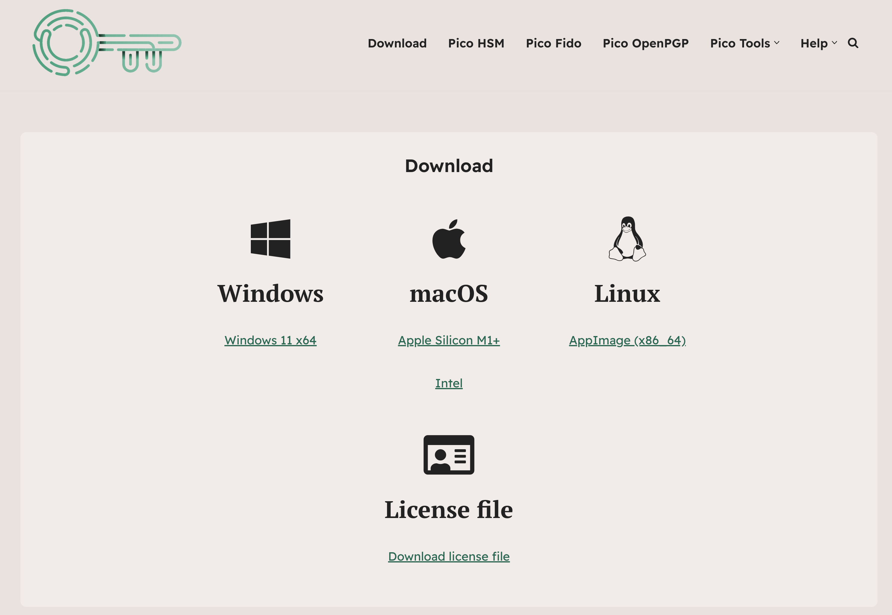

# Installation

Follow the steps for your operating system to install PicoKey App.

## Downloads
Download PicoKey App from the [official downloads page](https://www.picokeys.com/picokeyapp/).

Purchase a license to access the download. After your purchase, a download
link will arrive by email; the Downloads page provides builds for Windows,
Linux, and macOS, along with the corresponding license file.



!!! note
    Always download PicoKey App from official sources to avoid tampered binaries.

## Windows
1. Download the `.exe` portable build.
2. No installer is required. Just put the app in the desired folder.
3. Launch **PicoKey App** from the Start menu.

### Windows driver notes
PicoKey App uses standard USB drivers where possible. If your device is not detected, go to:

- [Troubleshooting](troubleshooting.md)

## macOS
1. Download the `.dmg` (or `.zip`) build.
2. Drag **PicoKey App** into **Applications**.
3. Open PicoKey App.

!!! tip
    If macOS blocks the app, open **System Settings → Privacy & Security** and allow it to run.

## Linux
1. Download the AppImage.
2. Make it executable:
   ```bash
   chmod +x PicoKey App.AppImage
   ```
3. Run it:
    ```bash
    ./PicoKey App.AppImage
    ```

!!! tip
If Linux does not detect the device, you may need to add udev rules or adjust
group permissions. See:

- [Troubleshooting](troubleshooting.md)

After installation, continue with [First steps](first-steps.md) to set up the device.
