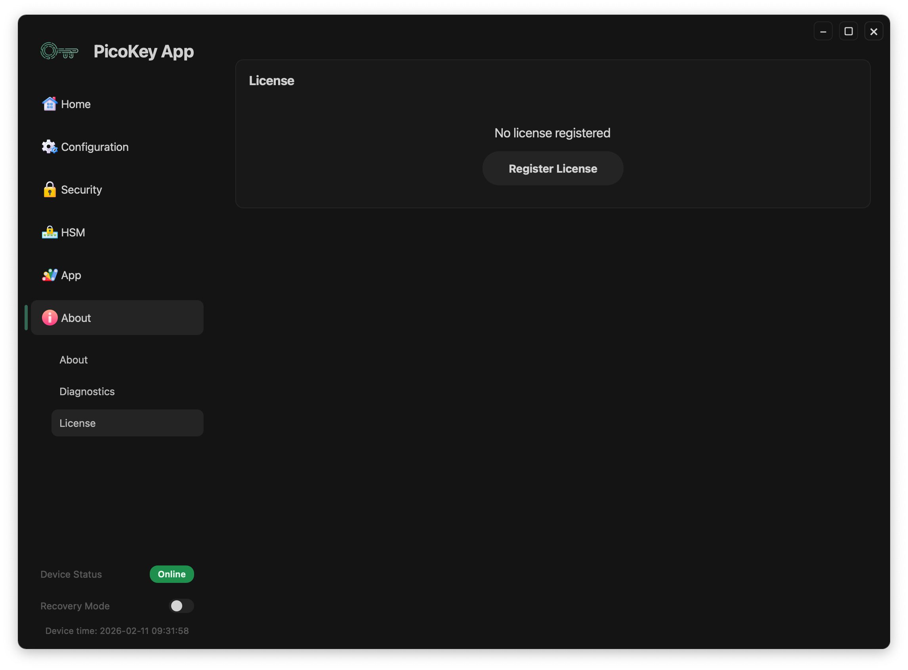
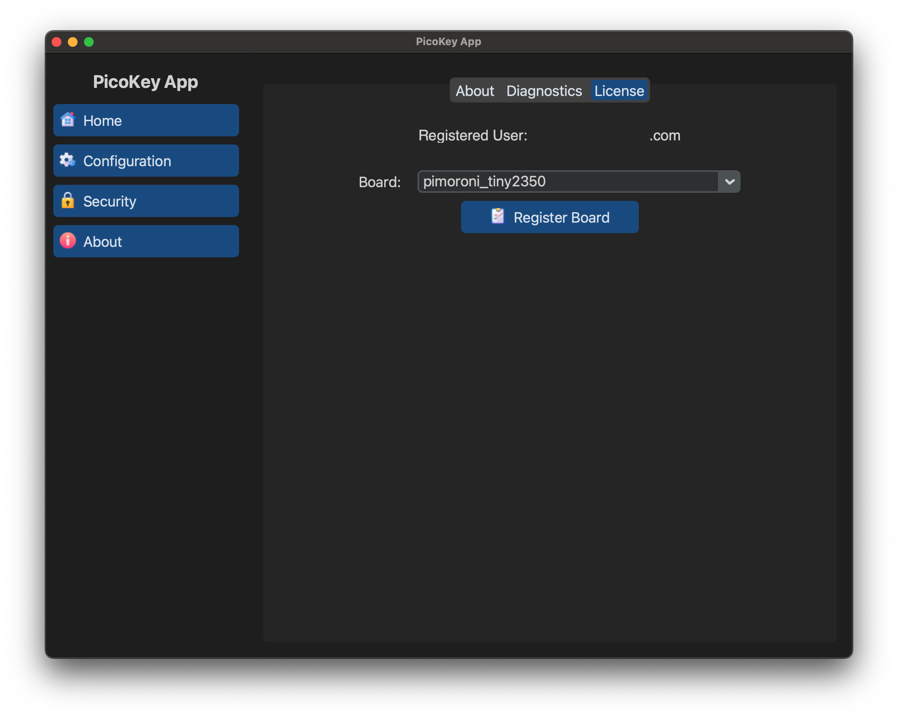

# License and registration

Use the **License** section to install licenses and register boards.

---

## Unregistered state

Without an installed license:

- The status shows *Not registered*
- The **Register License** button is available

---

## Registered state

After you install a license:

- The registered user is displayed
- The target board can be selected
- The **Register Board** button binds the license to the device

!!! Note
    The number of boards you can register depends on the seats included with
    your licenses. You can add seats by purchasing more licenses with the same
    email address.

