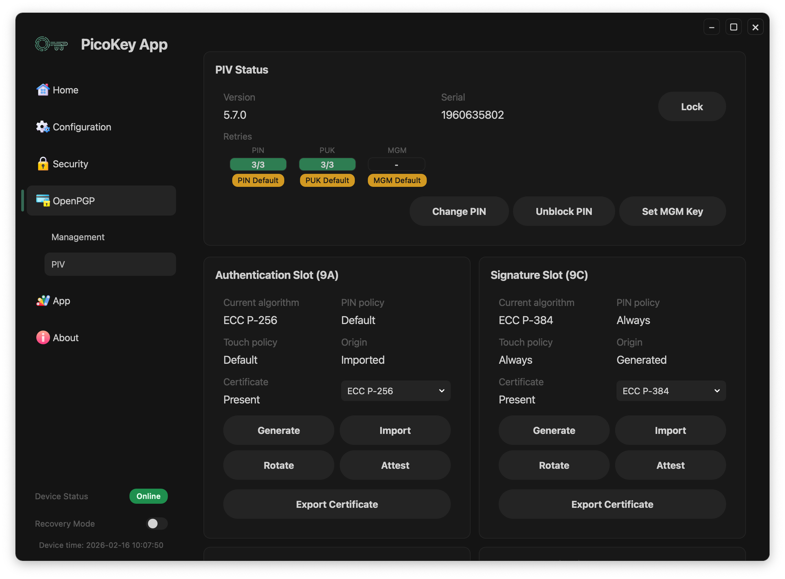
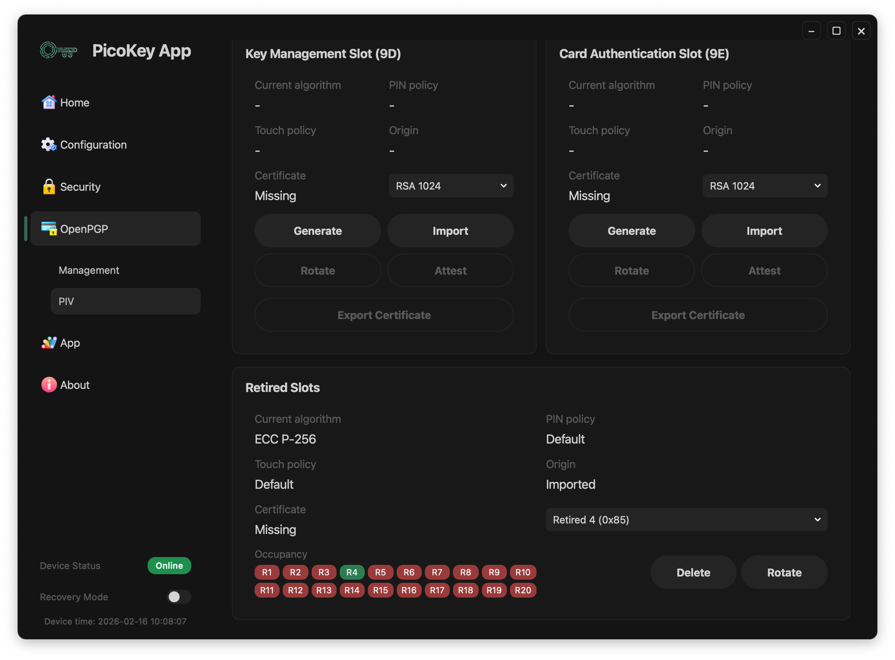
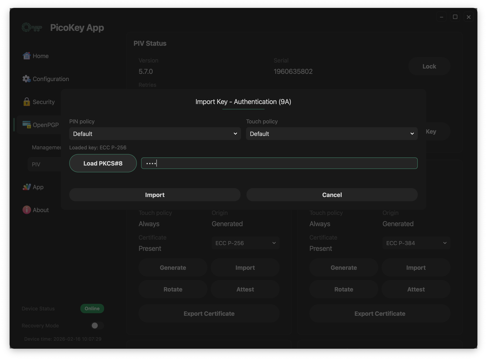
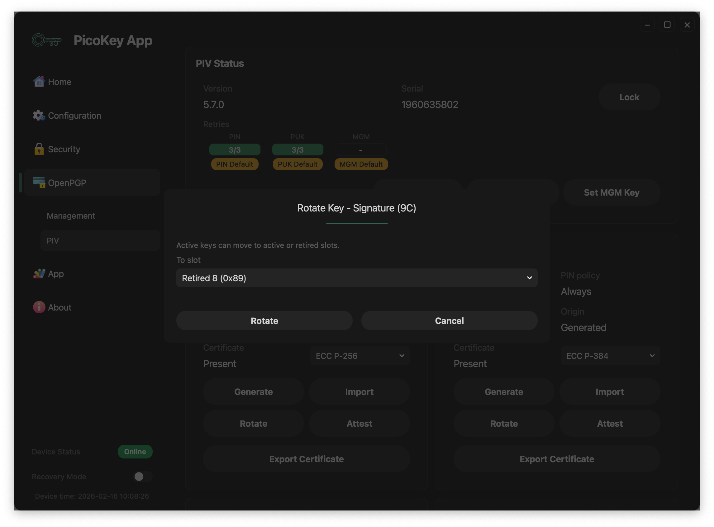

# PIV

Use **OpenPGP > PIV** in PicoKey App to view PIV status and manage PIV slots.

---

## PIV status

The **PIV Status** panel shows:

- `Version`
- `Serial`
- Retry counters for:
  - `PIN`
  - `PUK`
  - `MGM`
- Default credential indicators (`PIN Default`, `PUK Default`, `MGM Default`)
- Session action: `Unlock` / `Lock` (toggle)
- Credential actions:
  - `Change PIN`
  - `Unblock PIN`
  - `Set MGM Key`

Unlock the PIV session with the **MGM key** (management key); the user PIN does not unlock it.

!!! warning
    Default PIN/PUK/MGM values should be changed before production use.

---

## Slot model

The view groups the standard PIV slots into:

- **Authentication Slot (9A)**
- **Signature Slot (9C)**
- **Key Management Slot (9D)**
- **Card Authentication Slot (9E)**
- **Retired Slots**

For each slot, the UI shows:

- `Current algorithm`
- `PIN policy`
- `Touch policy`
- `Origin` (for example `Generated` or `Imported`)
- Certificate state (`Present` or `Missing`)

Depending on the slot state, you may also see:

- `Generate`
- `Import`
- `Rotate` (enabled only when applicable)
- `Attest` (enabled only when applicable)
- `Export Certificate` (enabled when a certificate is present)

!!! note
    Disabled buttons indicate operations not available for the current slot state.

---

## Import key workflow

Use the `Import Key - Authentication (9A)` dialog to load an existing private key into a PIV slot.

### Fields and controls

- `PIN policy`: defines when PIN verification is required for key usage.
- `Touch policy`: defines whether user presence/touch is required.
- `Load PKCS#8`: opens the file picker to load a PKCS#8 private key.
- `Loaded key`: read-only indicator with the parsed key type (example shown: `ECC P-256`).
- Passphrase input: unlocks the key when the PKCS#8 file is encrypted.
- `Import`: confirms and writes the key to the selected slot.
- `Cancel`: closes the modal without changes.

### Recommended flow

1. Open the target slot and click **Import**.
2. Set `PIN policy` and `Touch policy` according to your security requirements.
3. Click **Load PKCS#8** and select the key file.
4. Verify the `Loaded key` type is the expected one for that slot.
5. If needed, enter the key passphrase.
6. Click **Import** to apply the operation.

### Result

- On success, the slot origin becomes `Imported`.
- Slot metadata and certificate actions are refreshed based on the new key state.

!!! tip
    Ensure the imported key matches the selected slot algorithm and certificate policy.

---

## Rotate key workflow

Use the `Rotate Key - Signature (9C)` dialog to move an active key to another slot.

### Fields and controls

- `To slot`: destination selector (active slot, retired slot, or `Delete permanently`).
- `Rotate`: executes the move.
- `Cancel`: closes the modal without changes.

You can move an active key to another active slot or to a retired slot.

### Recommended flow

1. In the source slot, click **Rotate**.
2. Select the destination in `To slot`.
3. Confirm with **Rotate**.

### Result

- The key moves to the selected destination slot.
- Occupancy indicators in **Retired Slots** are updated when rotating keys into retired positions.
- Disabled rotate actions in some slots indicate there is no key material available to move.
- Current firmware can also move a retired key back to an active slot. Check
  the destination and certificate association before committing the move.
- Choosing `Delete permanently` removes key material irreversibly.

---

## Retired slots

The **Retired Slots** panel shows:

- Slot selector (example: `Retired 4 (0x85)`)
- Occupancy indicator for retired slots (`R1` to `R20`)
- Actions:
  - `Delete`
  - `Rotate`

Retired slots are archival positions used to store keys and certificates that are no longer active (for example, expired material kept for traceability).

Occupied retired slots are shown in green and empty ones in red.

!!! danger
    Moving, deleting, or rotating retired slot material can permanently impact
    certificate history and recovery workflows.

---

## Registration requirement

Register the board in PicoKey App before using this panel; otherwise, controls are restricted.
