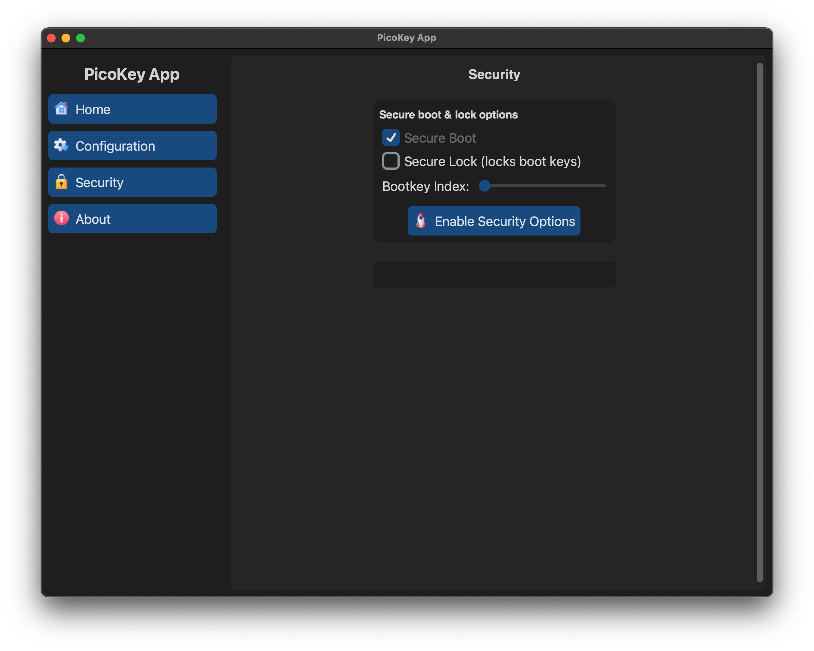

# Security initialization

Use PicoKey App to configure these **security initialization and provisioning options**.

These options are **applied during initialization** and shape the device's security model.

## Secure boot and lock options

### Secure Boot

When enabled:

- Firmware authenticity is verified at boot
- Only signed firmware images are allowed

!!! note
    Secure Boot is strongly recommended for production devices.

---

### Secure Lock

Locks the boot keys permanently.

- Prevents boot key replacement
- Protects against firmware downgrade attacks

!!! danger
    Secure Lock is irreversible. Enabling it incorrectly may permanently brick the device.

---

## Applying security options

After choosing the settings, click **Enable Security Options** to apply them to the device.

---

## Registration requirement

Register the board in PicoKey App before applying security settings from this panel.
